<p align="center">
  
</p>

<p align="center">
  <a href="https://github.com/ishandutta2007/Awesome-Awesome-Awesome"></a><a href="https://discord.gg/jc4xtF58Ve"></a>
  <a href="https://github.com/ishandutta2007/Awesome-Game-Engines/stargazers"></a>
  <a href="https://github.com/ishandutta2007/Awesome-Game-Engines/network/members"></a>
  <a href="https://github.com/ishandutta2007/Awesome-Game-Engines/blob/main/LICENSE"></a>
  <a href="https://github.com/ishandutta2007/Awesome-Game-Engines/pulls"></a>
  <a href="https://github.com/ishandutta2007/Awesome-Game-Engines/commits/main"></a>
  <a href="https://github.com/ishandutta2007"></a>
</p>

---

# 🎮 Awesome Game Engines

> A definitive, SEO-optimized, community-curated directory of **modern game engines**, **cross-platform runtimes**, **interactive 2D/3D editor workflows**, and **indie-to-AAA development ecosystems** for 2026.

Whether you are architecting a photorealistic AAA world, launching a viral cross-platform 2D indie hit, embedding high-performance 3D graphics in a web browser with WebGPU, or building an ultra-fast data-driven ECS simulation in Rust, this guide provides financial valuations, transparent pricing models, architectural comparisons, and GitHub community metrics to help you select the optimal game engine stack.

---

## 📑 Table of Contents

- [🌐 Sector Overview & Market Dynamics](#-sector-overview--market-dynamics)
- [☁️ SaaS & Hosted Platforms](#️-saas--hosted-platforms)
- [📦 Top Open-Source Game Engines (Ranked by Stars)](#-top-open-source-game-engines-ranked-by-stars)
- [📊 Architectural & Feature Comparison Matrix](#-architectural--feature-comparison-matrix)
- [💡 Decision Guide: Selecting Your Game Engine in 2026](#-decision-guide-selecting-your-game-engine-in-2026)
- [🤝 How to Contribute](#-how-to-contribute)
- [💖 Support](#-support)
- [##  Star History](#--star-history)
- [⚖️ Disclaimer & License](#️-disclaimer--license)

---

## 🌐 Sector Overview & Market Dynamics

The global game engine and interactive 3D development software market is estimated at **$5.2 billion in 2026**, projected to surpass **$11.8 billion by 2032** (~14.2% CAGR), propelled by continuous demand across video gaming, spatial computing (XR/VR), real-time film production, architectural visualization, and digital twins.

The sector is **moderately concentrated with a commercial duopoly at the enterprise top**—Epic Games (Unreal Engine) and Unity Software hold upwards of 70% of commercial engine revenue. However, the ecosystem exhibits **rapidly intensifying fragmentation at the indie, mobile, and web tiers**: developers increasingly migrate toward permissive open-source frameworks (such as Godot, Bevy, and Raylib) and lightweight specialized runtimes (Defold, Cocos, PlayCanvas) to eliminate platform risk, evade unexpected licensing changes, and retain absolute ownership over their source code and runtime budgets.

---

## ☁️ SaaS & Hosted Platforms

The table below catalogs leading commercial and SaaS-hosted game engines. Entries are **sorted descending by company size (valuation / market capitalization)** to reflect capital backing and enterprise stability.

| 🎮 Engine / Platform | 🏢 Company & Parent | 💰 Company Size (Valuation / Revenue) | 🏷️ Starting Tier Pricing | 🎁 Free Tier Limits | 🎯 Primary Target & Strengths |
| :--- | :--- | :--- | :--- | :--- | :--- |
| **[Unreal Engine](https://www.unrealengine.com/)** | Epic Games, Inc. | **~$31.5 Billion** Valuation *(~$5.6B Annual Revenue)* | **$1,850/seat/year** (Enterprise non-games) or **5% gross royalty** on games | **Free forever** for games generating <$1,000,000 gross lifetime revenue; includes 100% full C++ source access & Unreal Editor | Photorealistic AAA 3D, Nanite virtualized geometry, Lumen dynamic global illumination, virtual production |
| **[PlayCanvas](https://playcanvas.com/)** | Snap Inc. *(PlayCanvas Ltd)* | **~$16.5 Billion** Market Cap *(~$4.6B Annual Revenue)* | **$15/user/month** *(billed annually at $180/year for Personal)* | **Free forever** with 1 GB cloud storage; all projects & code must remain public; includes PlayCanvas web watermark | Browser-first 3D web games, WebGL 2.0 & WebGPU rendering, real-time multiplayer collaborative cloud editor |
| **[Unity](https://unity.com/)** | Unity Software Inc. *(NYSE: U)* | **~$9.0 Billion** Market Cap *(~$2.1B Annual Revenue)* | **$2,040/seat/year** *(or $170/seat/month billed annually for Unity Pro)* | **Free forever (Unity Personal)** for studios with <$200,000 annual gross revenue/funding; full editor and offline builds | Cross-platform 2D/3D games, massive asset store ecosystem, mobile dominance (iOS/Android), XR/AR |
| **[RPG Maker](https://rpgmakerofficial.com/)** | KADOKAWA Corporation *(Gotcha Gotcha Games)* | **~$3.2 Billion** Market Cap *(~$1.8B Annual Revenue)* | **$79.99 one-time** perpetual license *(RPG Maker MZ)* | **30-day free trial** with full access to map editor, character generator, and database; standalone game export expires after 30 days | Turn-based 2D JRPGs, narrative story games, rapid event-driven prototyping without programming |
| **[GameMaker](https://gamemaker.io/)** | Opera Ltd *(YoYo Games)* | **~$1.5 Billion** Market Cap *(~$400M Annual Revenue)* | **$99.99 one-time** perpetual license *(Professional tier for desktop/web commercial export)* | **Free forever** for non-commercial game creation; full visual editor & GML scripting with direct publishing to GX.games; commercial standalone exports locked behind paid tier | 2D indie platformers, action arcade games, rapid game jams, intuitive GameMaker Language (GML) |
| **[Construct 3](https://www.construct.net/)** | Scirra Ltd | **~$8.5 Million** Valuation *(~$5.0M Annual Revenue)* | **$129.99/year** *(or $24.99/month for Individual plan)* | **Free browser edition forever**; restricted to 50 event sheet events, 4 object types, 2 layers, and no commercial monetization | No-code 2D web and casual games, education, rapid prototyping directly in any desktop or tablet browser |

### 🔍 SaaS Engine Deep Dives

- **[Unreal Engine](https://www.unrealengine.com/)**: Epic's flagship engine powering modern AAA video games and virtual production. Unreal Engine 5 features **Nanite** (virtualized micropolygon geometry allowing film-quality assets without manual LODs), **Lumen** (fully dynamic global illumination and reflections), and **Chaos Physics**. The experimental MCP engine plugin and **Lore** version control system enable modern AI assistance and binary asset versioning directly in engine workflows.
- **[PlayCanvas](https://playcanvas.com/)**: A cloud-hosted collaborative development environment with an open-source WebGL/WebGPU runtime. Team members can simultaneously edit 3D scenes, tweak shaders, and write TypeScript code directly in a web browser like Google Docs, making it the premier choice for interactive web experiences, instant-play browser games, and enterprise e-commerce 3D product visualizers.
- **[Unity](https://unity.com/)**: The world's most widely deployed commercial game engine, with an estimated 60%+ share of mobile games. Offering both Universal Render Pipeline (URP) for lightweight multiplatform performance and High Definition Render Pipeline (HDRP) for high-end fidelity. Unity 6 introduces GPU Resident Drawer, WebGPU production support, and Neural Texture Compression (50%+ reduction in runtime memory footprints).
- **[RPG Maker](https://rpgmakerofficial.com/)**: The undisputed standard for grid-based 2D Japanese role-playing games. Provides out-of-the-box tilemap painting, battle calculation systems, inventory, quest variables, and character asset generators. Modern editions (MZ and WITH) provide modular plugin systems and HTML5/desktop distribution.
- **[GameMaker](https://gamemaker.io/)**: The legendary 2D development tool behind indie masterworks like *Undertale*, *Hotline Miami*, and *Katana Zero*. Provides both visual drag-and-drop block logic and GML code scripting, zero-friction 2D sprite workflows, and one-click export pipelines.
- **[Construct 3](https://www.construct.net/)**: A pure in-browser 2D game engine built on Web standards. Features an event-sheet architecture that replaces traditional programming with readable conditional logic, integrated sprite physics, tilemap editors, and WebGPU hardware acceleration.

---

## 📦 Top Open-Source Game Engines (Ranked by Stars)

The following open-source game engines and development runtimes are **strictly sorted descending by GitHub_Stars_Counts**. Each badge links directly to that repository's stargazers community page.

### 1. [Godot Engine](https://github.com/godotengine/godot) [](https://github.com/godotengine/godot/stargazers)
- **Primary Languages**: C++, GDScript, C#
- **License**: MIT *(Permissive — zero royalty, zero telemetry, zero vendor lock-in)*
- **GitHub Repository**: [`godotengine/godot`](https://github.com/godotengine/godot)
- **Overview**: The reigning champion of open-source game development. Features a dedicated, lightning-fast visual editor, intuitive node-and-scene tree composition, first-class 2D pixel engines, and modern Vulkan-powered 3D rendering. Proven in production by hit titles including *Slay the Spire 2*, *Brotato*, *Dome Keeper*, and *Cassette Beasts*.

### 2. [Bevy](https://github.com/bevyengine/bevy) [](https://github.com/bevyengine/bevy/stargazers)
- **Primary Languages**: Rust
- **License**: MIT / Apache-2.0
- **GitHub Repository**: [`bevyengine/bevy`](https://github.com/bevyengine/bevy)
- **Overview**: A refreshingly simple data-driven game engine built from scratch in Rust. Built upon an ultra-fast, ergonomic Entity Component System (ECS), Bevy features modular plugins, a custom render graph, hot reloading, and cross-platform compilation (Windows, macOS, Linux, WebAssembly/WebGPU).

### 3. [Raylib](https://github.com/raysan5/raylib) [](https://github.com/raysan5/raylib/stargazers)
- **Primary Languages**: C / C++
- **License**: zlib/libpng
- **GitHub Repository**: [`raysan5/raylib`](https://github.com/raysan5/raylib)
- **Overview**: A simple and easy-to-use software library to enjoy videogames programming. Raylib has no heavy visual editor or bloat—pure C code with OpenGL abstraction, immediate-mode style 2D/3D draw APIs, 50+ language bindings (Python, Rust, Go, C#), and exceptional educational adoption.

### 4. [libGDX](https://github.com/libgdx/libgdx) [](https://github.com/libgdx/libgdx/stargazers)
- **Primary Languages**: Java, Kotlin
- **License**: Apache-2.0
- **GitHub Repository**: [`libgdx/libgdx`](https://github.com/libgdx/libgdx)
- **Overview**: A battle-tested cross-platform Java game development framework. Powers landmark indie hits like *Slay the Spire* and *Mindustry*. Provides unified OpenGL bindings, physics wrappers (Box2D, Bullet), audio, and input handling across Windows, Linux, macOS, Android, iOS, and WebAssembly.

### 5. [PlayCanvas Engine](https://github.com/playcanvas/engine) [](https://github.com/playcanvas/engine/stargazers)
- **Primary Languages**: JavaScript, TypeScript
- **License**: MIT
- **GitHub Repository**: [`playcanvas/engine`](https://github.com/playcanvas/engine)
- **Overview**: The open-source lightweight 3D WebGL and WebGPU engine powering the PlayCanvas platform. Features physically based rendering (PBR), glTF 2.0 asset pipelines, 3D spatial audio, and Ammo.js/Wasm rigid-body physics, all optimized for high-FPS browser games without plugins.

### 6. [Cocos Engine](https://github.com/cocos/cocos-engine) [](https://github.com/cocos/cocos-engine/stargazers)
- **Primary Languages**: TypeScript, C++
- **License**: MIT
- **GitHub Repository**: [`cocos/cocos-engine`](https://github.com/cocos/cocos-engine)
- **Overview**: The open-source runtime and framework foundation of Cocos Creator. Heavily optimized for high-performance 2D and 3D games across mobile (iOS/Android), desktop, and instant web/mini-game ecosystems (WeChat Mini Games, TikTok, Facebook Instant Games).

### 7. [Open 3D Engine (O3DE)](https://github.com/o3de/o3de) [](https://github.com/o3de/o3de/stargazers)
- **Primary Languages**: C++, Python
- **License**: Apache-2.0 / MIT
- **GitHub Repository**: [`o3de/o3de`](https://github.com/o3de/o3de)
- **Overview**: An open-source, modular, real-time 3D engine governed by the Linux Foundation (originated from Amazon Lumberyard and CryEngine). Features the Atom multi-threaded physically based renderer, extensible "Gems" architecture, Python automation, and PhysX simulation.

### 8. [Stride](https://github.com/stride3d/stride) [](https://github.com/stride3d/stride/stargazers)
- **Primary Languages**: C#, .NET
- **License**: MIT
- **GitHub Repository**: [`stride3d/stride`](https://github.com/stride3d/stride)
- **Overview**: Formerly known as Xenko, Stride is a full-featured open-source 2D/3D C# game engine. Features a complete visual scene editor, modern PBR graphics pipeline, full .NET 8/9 C# scripting with Roslyn compilers, and VR/XR support—positioning it as the premier open-source C# alternative to Unity.

### 9. [Wicked Engine](https://github.com/turanszkij/WickedEngine) [](https://github.com/turanszkij/WickedEngine/stargazers)
- **Primary Languages**: C++
- **License**: MIT
- **GitHub Repository**: [`turanszkij/WickedEngine`](https://github.com/turanszkij/WickedEngine)
- **Overview**: An advanced open-source C++ game engine emphasizing cutting-edge modern graphics programming. Features DirectX 12 and Vulkan backends, hardware ray tracing, path tracing, atmospheric scattering, mesh shaders, and Lua scripting.

### 10. [Flax Engine](https://github.com/FlaxEngine/FlaxEngine) [](https://github.com/FlaxEngine/FlaxEngine/stargazers)
- **Primary Languages**: C++, C#
- **License**: Source-Available / Custom EULA *(Free up to $250k revenue; 4% royalty thereafter)*
- **GitHub Repository**: [`FlaxEngine/FlaxEngine`](https://github.com/FlaxEngine/FlaxEngine)
- **Overview**: A lightweight 64-bit game engine offering high-fidelity 3D graphics, a visual editor, C# and C++ scripting, and Vulkan/DirectX 12 render pipelines. Positioned for developers seeking Unity-like workflows combined with Unreal-like lightweight native code generation.

### 11. [Defold](https://github.com/defold/defold) [](https://github.com/defold/defold/stargazers)
- **Primary Languages**: C++, Lua
- **License**: Defold License *(Permissive source-available, completely free with no royalties)*
- **GitHub Repository**: [`defold/defold`](https://github.com/defold/defold)
- **Overview**: Originally developed by King (creators of *Candy Crush*), Defold is a turn-key cross-platform 2D and lightweight 3D engine. It compiles tiny binary footprints (sub-5MB), features blazing-fast cold compile times, Lua scripting, and rock-solid mobile/web/console publishing.

### 12. [Panda3D](https://github.com/panda3d/panda3d) [](https://github.com/panda3d/panda3d/stargazers)
- **Primary Languages**: C++, Python
- **License**: Modified BSD
- **GitHub Repository**: [`panda3d/panda3d`](https://github.com/panda3d/panda3d)
- **Overview**: A mature, battle-hardened open-source framework for 3D rendering and games developed jointly by Disney and Carnegie Mellon University. Features Python bindings over a high-performance C++ core, used widely for university robotics simulations, VR labs, and commercial MMORPGs like *Toontown Online*.

### 13. [Stencyl Engine](https://github.com/Stencyl/stencyl-engine) [](https://github.com/Stencyl/stencyl-engine/stargazers)
- **Primary Languages**: Haxe
- **License**: MIT
- **GitHub Repository**: [`Stencyl/stencyl-engine`](https://github.com/Stencyl/stencyl-engine)
- **Overview**: The core open-source runtime powering the Stencyl visual game development toolkit. Compiles Haxe logic to native C++ binaries across desktop and mobile, powering block-based visual scripting workflows for educators and rapid game jam creators.

---

## 📊 Architectural & Feature Comparison Matrix

| 🕹️ Engine | 🏛️ Architecture | 🎨 2D Fidelity | 🌟 3D Fidelity | 💻 Primary Language | 🖥️ Visual Editor | 🌐 Web/HTML5 Export | 📱 Mobile Export |
| :--- | :--- | :--- | :--- | :--- | :--- | :--- | :--- |
| **Unreal Engine 5** | Object/Actor Component | ⚠️ Basic | 🏆 AAA Photoreal (Nanite/Lumen) | C++, Blueprints | ✅ Full Desktop Editor | ❌ Deprecated | ✅ iOS / Android |
| **Unity 6** | GameObject & DOTS ECS | 🌟 Production 2D | 🌟 High-End (URP/HDRP) | C# | ✅ Full Desktop Editor | ✅ Production WebGPU | ✅ Dominant Mobile |
| **Godot 4.x** | Node Tree Hierarchy | 🏆 First-Class Dedicated | 🌟 High-End PBR / Vulkan | GDScript, C#, C++ | ✅ Full Lightweight Editor | ✅ WebAssembly / WebGL | ✅ iOS / Android |
| **Bevy** | Pure Data-Driven ECS | 🌟 High | 🌟 Modern PBR / RenderGraph | Rust | ❌ Code-First (Community GUI) | ✅ WebAssembly / WebGPU | ⚠️ Experimental |
| **Raylib** | Minimalist Functional API | 🌟 Clean Immediate | 🌟 Fast Lightweight 3D | C, C++ (50+ bindings) | ❌ Code-Only Library | ✅ WebAssembly / Emscripten | ✅ Android |
| **libGDX** | Object-Oriented Framework | 🏆 World-Class 2D | ⚠️ Basic 3D | Java, Kotlin | ❌ Code-Only Framework | ✅ WebGL (TeaVM / GWT) | ✅ iOS / Android |
| **PlayCanvas** | Entity-Component Hierarchy | 🌟 Web 2D | 🏆 Premier Web 3D (WebGPU) | TypeScript, JavaScript | ✅ Web Cloud Editor | 🏆 Native Browser | ✅ Mobile Web / PWA |
| **Stride** | Component Entity System | 🌟 Full 2D | 🌟 High-End PBR (.NET) | C# (.NET 8/9) | ✅ Full Desktop Editor | ⚠️ Experimental | ✅ Android / iOS |
| **Defold** | Game Object & Lua Scripting | 🏆 Sub-5MB 2D | 🌟 Lightweight 3D | Lua, C++ | ✅ Turnkey Desktop Editor | 🏆 Ultra-Fast HTML5 | 🏆 Elite Mobile |
| **Cocos Creator** | Entity-Component Framework | 🏆 Top-Tier 2D | 🌟 Modern 3D | TypeScript | ✅ Full Desktop Editor | 🏆 WeChat/HTML5 Leaders | ✅ iOS / Android |
| **O3DE** | Modular Gem Component ECS | ⚠️ Basic | 🏆 AAA Real-Time (Atom PBR) | C++, Python, Lua | ✅ Full Desktop Suite | ❌ No | ⚠️ Experimental |

---

## 💡 Decision Guide: Selecting Your Game Engine in 2026

```mermaid
flowchart TD
    Start["🎯 What is your primary project goal?"] --> Q1{"Do you need a full GUI Editor or Code-Only?"}
    
    Q1 -->|Full GUI Editor| Q2{"What is your target fidelity & budget?"}
    Q1 -->|Code-Only Framework| Q3{"Which programming language?"}
    
    Q2 -->|AAA Photorealistic 3D| UE["⚡ Unreal Engine 5<br/>(Nanite, Lumen, $1M free royalty)"]
    Q2 -->|Cross-Platform Indie 2D/3D| Q4{"Licensing priority?"}
    Q2 -->|Web Browser-First 3D| PC["🌐 PlayCanvas<br/>(Collaborative Cloud + WebGPU)"]
    Q2 -->|Ultra-Lightweight 2D Mobile| DF["📱 Defold<br/>(Tiny <5MB binaries, Lua)"]
    
    Q4 -->|100% Free & Open-Source (MIT)| GD["🤖 Godot Engine<br/>(GDScript / C#, zero platform risk)"]
    Q4 -->|C# / Asset Store Scale| UN["🛠️ Unity 6<br/>(Mobile leader, extensive ecosystem)"]
    Q4 -->|C# / Open-Source Alternative| ST["📦 Stride 3D<br/>(Modern .NET, MIT license)"]

    Q3 -->|Rust| BV["🦀 Bevy<br/>(Data-driven ECS, multi-threaded)"]
    Q3 -->|C / C++| RL["📐 Raylib<br/>(Simple, zero bloat, educational)"]
    Q3 -->|Java / Kotlin| GDX["☕ libGDX<br/>(Rock-solid 2D cross-platform)"]
```

- **Choose Godot Engine** if you want complete peace of mind, zero royalties, full source code ownership, a lightweight download (<100MB), and top-tier 2D and stylized 3D capabilities.
- **Choose Unreal Engine 5** if you are targeting realistic lighting, large open-world environments, Nanite geometry, virtual cinematography, or AAA console/PC fidelity.
- **Choose Unity 6** if you are building mobile-first games, require access to a massive commercial asset store, or rely on proven C# enterprise game development teams.
- **Choose Bevy** if you love Rust, desire compile-time type safety, and want an ergonomic data-oriented Entity Component System (ECS) architecture.
- **Choose PlayCanvas** if your game lives inside web browsers, interactive 3D e-commerce configurators, or cross-platform instant web links.
- **Choose Defold** if your target is mobile devices with strict bandwidth caps (sub-5MB initial download) and instant boot times.
- **Choose Raylib** if you are learning computer graphics, prototyping algorithms, or building customized game tools in pure C/C++.

---

## 🤝 How to Contribute

We welcome community pull requests, engine additions, and factual benchmark updates!

1. 🍴 **Fork the repository** on GitHub.
2. 🌿 **Create a new branch** (`git checkout -b feature/add-engine-profile`).
3. 📝 **Add or update entries** in `README.md` following established table formatting, specific pricing figures, and verified Stars_Badges.
4. 🔗 **Ensure all Stars_Badges** link to `https://github.com/<owner>/<repo>/stargazers`.
5. 🚀 **Submit a Pull Request** with a succinct description of your changes.

---

## 💖 Support

A huge thank you to all contributors, developers, and open-source maintainers who make the modern game engine ecosystem vibrant and accessible!

If you find this curated directory helpful for your projects, research, or team stack selection, please consider supporting the project:
* ⭐ **Star this repository** to show appreciation and help others discover it.
* 🍴 **Fork and share** with your network, team, and developer communities.
* ☕ **Buy me a coffee / sponsor the project** on GitHub to support continuous updates and open-source research:
  
  [](https://github.com/sponsors/ishandutta2007)
  
  👉 **[Visit Sponsor Dashboard](https://github.com/sponsors/ishandutta2007)**

---

##  Star History

[](https://star-history.dera.page/#ishandutta2007/Awesome-Game-Engines&type=date&legend=top-left)

---

## ⚖️ Disclaimer & License

* This repository is an independent, **community-curated guide** intended for educational and architectural evaluation purposes.
* Financial valuations, market capitalization numbers, and pricing tiers reflect publicly available figures as of **October 2026**.
* All product names, logos, and registered trademarks belong to their respective corporate entities (Epic Games, Unity Software, Snap Inc., KADOKAWA, Opera Ltd, Scirra Ltd, Linux Foundation).
* Distributed under the **[MIT License](LICENSE)**.
